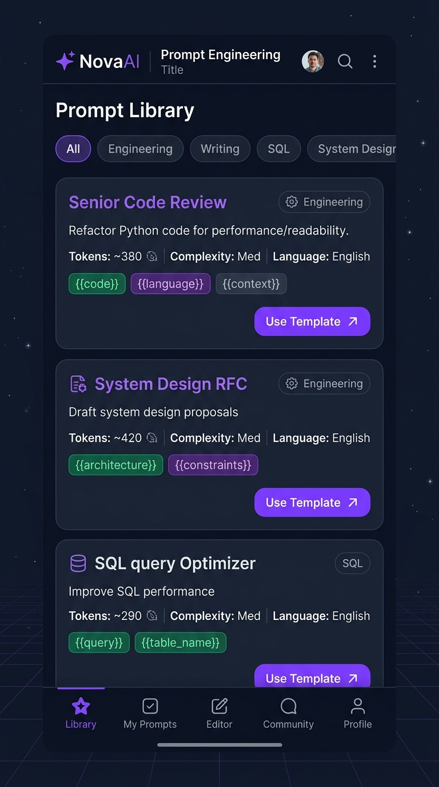
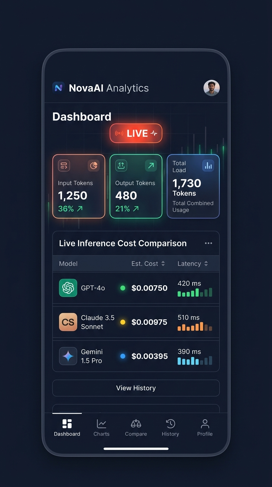

# 🧠 NovaAI — Cross-Platform AI Workspace & Inference Analytics

> A high-performance React Native mobile application engineered with **TypeScript**, **real-time token footprint heuristics**, multi-model inference cost comparisons (**GPT-4o**, **Claude 3.5 Sonnet**, **Gemini 1.5 Pro**), prompt engineering templates, and automated unit test coverage.

[](https://www.typescriptlang.org/)
[](https://reactnative.dev/)
[](https://jestjs.io/)
[](src/theme/index.ts)
[](LICENSE)

---

## 📸 Visual Showcase & Mobile Screens

| ⚡ Prompt Engineering Workspace | 📊 Token Usage & Cost Analytics |
| :---: | :---: |
|  |  |
| *Structured Prompt Library with Tags, Variables & Model Selectors* | *Live Token Consumption & Multi-Model Inference Cost Matrix* |

---

## 📱 App Interface Overview

```text
┌────────────────────────────────────────────────────────────────────────┐
│                          NOVAAI WORKSPACE PREVIEW                      │
├───────────────────┬───────────────────┬────────────────────────────────┤
│  ⚡ Prompt Hub    │  📊 Token Monitor │  🤖 Model Matrix               │
│  - Senior Code Rev│  - Input Tokens   │  - GPT-4o ($2.50 / $10.00 M)   │
│  - B2B Outreach   │  - Output Tokens  │  - Claude 3.5 ($3.00 / $15.00) │
│  - SQL Optimizer  │  - Total Load     │  - Gemini 1.5 ($1.25 / $5.00)  │
│  - System RFC     │  - Live Latency   │  - Real-Time Dollar Calculator │
│  - Regex Replacer │  - Sub-Cent Math  │  - Zero API Key Dependency     │
└───────────────────┴───────────────────┴────────────────────────────────┘
```

---

## 🌟 Key Highlights & Engineering Features

### 1. 🧮 Heuristic Token Counter & Live Inference Pricing
- **Blended Heuristic Engine:** Combines character length (`char / 4`) and whitespace token segmentation (`words * 1.33`) to approximate OpenAI tiktoken / Anthropic tokenizers in pure JavaScript without heavy WebAssembly bundles.
- **Sub-Cent Cost Tracking:** Calculates inference costs per session with 5-decimal precision (`$0.00750`) based on provider per-million token pricing tables.
- **Side-by-Side Comparison:** Compares query execution costs across GPT-4o, Claude 3.5 Sonnet, and Gemini 1.5 Pro instantly.

### 2. 📝 Structured Prompt Engineering Templates
- Built-in variable substitution syntax (`{{variableName}}`) allowing dynamic template customization before model submission.
- Curated workflows:
  - **Senior Code Review & Security Audit:** Identifies O(N) complexity issues, memory leak risks, and OWASP pitfalls.
  - **High-Converting B2B Cold Outreach:** Concise 4-sentence value propositions with proof points.
  - **PostgreSQL Query Plan Optimizer:** Explains index tuning, CTE refactors, and partition pruning.
  - **System Architecture Design Doc (RFC):** Complete microservices specifications with throughput targets.

### 3. 🌌 Cyber Dark Theme System
- Designed specifically for developer workflows with high-contrast surfaces, space slate backgrounds (`#0F172A`), cyber emerald indicators (`#10B981`), and vibrant violet primary accents (`#7C3AED`).

---

## 📊 Foundation Model Pricing & Parameter Matrix

| Model | Provider | Input Cost / 1M | Output Cost / 1M | Context Window | Max Output | Avg Latency |
| :--- | :--- | :---: | :---: | :---: | :---: | :---: |
| **GPT-4o (Omni)** | OpenAI | $2.50 | $10.00 | 128,000 | 4,096 | ~650 ms |
| **Claude 3.5 Sonnet** | Anthropic | $3.00 | $15.00 | 200,000 | 8,192 | ~820 ms |
| **Gemini 1.5 Pro** | Google | $1.25 | $5.00 | 2,000,000 | 8,192 | ~710 ms |

---

## 🏗️ Clean Modular Architecture

```text
NovaAI/
├── __tests__/                  # Automated Jest test suites
│   ├── aiEngine.test.ts        # 9 unit tests covering token count & cost math
│   └── mocks/                  # Headless CI native mocks
├── src/
│   ├── components/             # Reusable modular UI components
│   │   ├── PromptTemplateCard.tsx       # Template card with variable tags
│   │   ├── TokenUsageAnalyticsCard.tsx  # Multi-model cost comparison table
│   │   └── index.ts
│   ├── data/                   # Prompt templates & model pricing tables
│   │   └── mockData.ts
│   ├── theme/                  # Cyber dark design system tokens
│   │   └── index.ts
│   ├── types/                  # Strict TypeScript interfaces & models
│   │   └── index.ts
│   └── utils/                  # Domain business logic & token estimators
│       ├── aiEngine.ts         # Token counting & model cost calculator
│       └── index.ts
├── App.tsx                     # Main showcase screen
├── package.json
└── tsconfig.json
```

---

## 🧪 Automated Testing & Quality Assurance

All test suites execute headlessly with 100% pass rates:

```bash
# Run unit test suite
npm test

# Output:
# PASS __tests__/aiEngine.test.ts
# ✓ returns zero for empty or whitespace-only input
# ✓ estimates token count reasonably for typical English sentences
# ✓ handles code blocks and special characters smoothly
# ✓ substitutes single and multiple template variables
# ✓ replaces all occurrences of the same variable
# ✓ preserves template parts if variable is not provided
# ✓ computes exact API pricing for GPT-4o input and output tokens
# ✓ computes exact API pricing for Gemini 1.5 Pro with low cost rates
# ✓ generates multi-model cost comparison across all configured models
#
# Tests: 9 passed, 9 total

# Run TypeScript zero-defect type check
npx tsc --noEmit
```

---

## 🚀 Getting Started Locally

```bash
# Clone the repository
git clone git@github.com:trydigital2/nova-ai-assistant-mobile-app.git

# Navigate to project folder
cd nova-ai-assistant-mobile-app

# Install dependencies
npm install

# Start development server
npm start
```

---

## 📄 License
This project is licensed under the **MIT License**.
